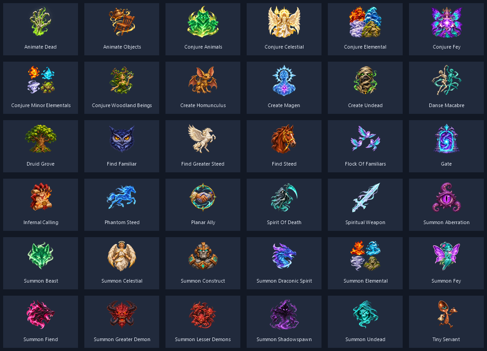

# Quick Summon

Summon and manage creatures from the **Actions** tab in **Fantasy Grounds Unity 5E Legacy (2014)**. Quick Summon handles creature selection, spell slots, the Combat Tracker, and spell-specific scaling for **36 spell profiles**.

[Download the latest release](https://github.com/alperozisik/FG-Quick-Summon/releases/latest) · [Türkçe](README.tr.md) · [Changelog](CHANGELOG.md)

## Installation

1. Download `QuickSummon.ext` from [Releases](https://github.com/alperozisik/FG-Quick-Summon/releases) and copy it to your Fantasy Grounds data folder under `extensions/`.
2. For the custom **Spiritual Weapon** map token, download `Spiritual_Weapon.png` from the same release. Create `tokens/QuickSummon/` under the Fantasy Grounds data folder and place the PNG there.
3. Enable **Quick Summon** in the campaign launcher. Use a **5E Legacy** campaign and load the NPC modules you want to use on the GM side.
4. Enable [Initiative Nanny](https://forge.fantasygrounds.com/shop/items/2089/view) if you want `AFTERTURN` and `SHARETURN` to control initiative order.

The chat announces **Quick Summon v0.1.24 loaded.** with the extension icon. For updates to an open campaign, replace the package and use `/reload` when you are ready.

## Casting a spell

1. Open the caster’s character sheet and use **Actions → Cast** on a supported spell. Quick Summon matches the spell name and checks the recorded base level when available.
2. Choose a slot or a ritual if offered. The lowest usable slot is selected by default. Empty slots stay visible and disabled where the slot picker applies. The upcast note shows changes at the chosen level and calls out levels with no additional benefit.
3. Choose any parameters the caster controls, such as the number and CR combination or a spirit’s form. When the GM chooses the creature, the GM receives a separate selection step. A step with a single valid outcome can resolve automatically.
4. **Confirm** adds the summon to the Combat Tracker. Quick Summon spends the selected slot, reports it in chat, and adds any supported concentration or duration effect. The GM can then drag the token from the tracker onto the map.

**Cancel** or the close button stops a pending summon before confirmation. Counterspell follows the table’s normal procedure. Close the pending summon if the spell is countered and apply slot use as part of that procedure.

### Choosing creatures

- **Refresh** rescans the host’s loaded NPC modules and updates slot availability. It clears the current creature selection.
- **Select randomly** appears when at least two eligible choices are available. The result stays editable and waits for **Confirm**. For **Animate Objects**, it finds a combination that spends the entire size budget when possible and otherwise uses the highest reachable amount.
- **Conjure Elemental** filters the GM’s list by the caster’s selected Air/Earth/Fire/Water option as well as creature type and slot-based CR. Explicit element tags and whole-word names are supported, along with known Legacy elemental families (including mixed mephits). Records whose element cannot be established are excluded; custom creatures should include an element tag such as `Elemental (air)`. This filter does not restrict Conjure Minor Elementals.
- The GM can open an NPC’s source sheet using the shortcut to the left of its name. The player’s list shows creature names, types, and CRs where available. It contains no links to the source sheets.
- The catalogue includes modules loaded by the GM, including modules the player cannot open. Eligible creature names from those modules can appear in a player’s chooser.
- A matching NPC record must be present in a loaded module. Some spirit forms use named templates supplied by the corresponding rules module or an automation module. The extension contains the rules and artwork used to run the flow.

## Combat Tracker and ownership

- With [Pets](https://forge.fantasygrounds.com/shop/items/1960/view) loaded and auto assignment On, friendly summons are added to the caster’s Pets list as the actual NPC record linked to the tracker. Removing a summon from the tracker also removes its Pets entry. A summon that becomes hostile on concentration loss leaves Pets and remains under GM control. Pets is optional; the normal workflow works without it. This applies to newly created summons.
- **Options → Quick Summon → Auto Assign Summoned NPC** defaults to **On**. Friendly summons are assigned to the player who controls the caster, and their Combat Tracker-linked NPC sheet is shared with and opened for that player in its locked state. Set it to **Off** to assign them manually.
- If the caster already has initiative, the summon uses the spell’s initiative behavior. Spells can roll individually, roll once for the summoned group, or use the caster’s value. Quick Summon supplies the caster link for `AFTERTURN` and `SHARETURN` effects.
- **Find Familiar** adds a persistent `Familiar` effect to the new CT entry.
- **Spiritual Weapon** shares the caster’s turn through `SHARETURN`. Its **Spiritual Weapon Strike** bonus action appears in the NPC sheet and CT with the caster’s spell attack bonus, force damage, and Legacy upcast scaling. Slot 2 and 3 notices show the same base 1d8 damage; another d8 is gained at slots 4, 6, and 8. Its movement is 20 ft. and the CT entry carries `Incapacitated` and `NOREACTION`. The caster must be on the tracker.
- Scaled spirits use the selected slot for AC and hit points and take their spell attack bonus, save DC, and proficiency from the caster. How much action text can be scaled depends on the module’s stat block wording.

## Unsummon and undo

- **Warn before auto unsummon** defaults to **Yes**. The GM sees the affected summons and the known reason. **Unsummon** removes the group, while **Ignore** leaves the creatures on the tracker for manual management. **No** removes them immediately.
- **`/undounsummon`** restores the last group removed by Quick Summon, including current HP, conditions, initiative, and available Pets and map links. The history exists only in host memory. Manual tracker deletions are outside that history. Expired concentration and summon timers are not restored.
- [Polymorphism](https://forge.fantasygrounds.com/shop/items/156/view) CT swaps carry the same concentration cast identity across forms. Quick Summon also includes a compatibility hook for [5e Undo Last Damage/Heal](https://forge.fantasygrounds.com/shop/items/719/view) that preserves the Wild Shape effect when undoing damage on the current form.

**Live verification for v0.1.24.** In Fantasy Grounds 5.1.16, a summon and its concentration effect survived entering and leaving Wild Shape. The confirmation correctly identified a replacement spell and a failed concentration save. Ignore, Unsummon, and single-summon restoration worked. The summon lost its AFTERTURN effect on transformation. 5e Undo preserved Wild Shape and reported success, but the form retained 12 wounds. Bulk restoration and restoration of a map token or Pets entry still need live verification.

## Summon duration and rests

- A temporary summon carries a **Summoned Creature** effect with its remaining duration in rounds. Expiring or removing this effect dismisses the summon from the Combat Tracker and removes its linked Pets record. Duration advances through FG turns and rest commands, rather than real-world elapsed time.
- Timer initiative is captured from the **active CT actor when casting starts**, including reaction casts on another actor’s turn. Later chooser steps retain that value. Spiritual Weapon expires at turn end: its Initiative Adjust is the captured value minus **0.1** (for example, 13 becomes 12.9). This applies to newly started casts; existing timers retain their initiative.
- Short rest subtracts **1 hour**; long rest subtracts **8 hours**. Both party rest and the caster’s individual rest are supported, including a rest started on the player’s character sheet. A party rest decrements each timer once.
- For **Conjure Elemental** and **Conjure Fey**, a caster’s short or long rest breaks concentration **before** elapsed time is applied: the creature remains on the CT as hostile, loses its Summoned Creature timer, and leaves Pets. This also works if party rest visits the summon before the caster.
- Concentration remains linked to the caster. If concentration loss turns a creature hostile, its Summoned Creature effect is removed **without dismissing it**, and the GM takes over. Special delayed disappearance remains a GM ruling.
- Permanent creations, familiars, and steeds do not receive a temporary lifetime timer. A creature brought through Gate stays when the portal ends. Animate Dead/Create Undead control limits are distinct from creature lifetimes and remain manual. Druid Grove guardians receive the ordinary 24-hour grove duration; the GM handles permanent groves separately.
- On reload, existing managed summon sheets are locked, Spiritual Weapon regains a missing Incapacitated effect, and any existing linked duration is transferred to a Summoned Creature timer using its remaining rounds.

## Supported spells

| Group | Profiles |
| --- | --- |
| Conjuration and calling | Conjure Animals, Conjure Celestial, Conjure Elemental, Conjure Fey, Conjure Minor Elementals, Conjure Woodland Beings, Gate, Infernal Calling, Planar Ally, Summon Greater Demon, Summon Lesser Demons |
| Scaling spirits | Spirit of Death, Summon Aberration, Summon Beast, Summon Celestial, Summon Construct, Summon Draconic Spirit, Summon Elemental, Summon Fey, Summon Fiend, Summon Shadowspawn, Summon Undead |
| Familiars and mounts | Find Familiar, Find Greater Steed, Find Steed, Flock of Familiars, Phantom Steed |
| Animation and creation | Animate Dead, Animate Objects, Create Homunculus, Create Magen, Create Undead, Danse Macabre, Druid Grove, Tiny Servant |
| Spell effect | Spiritual Weapon |

### Scope and manual rulings

- Quick Summon uses the 2014 rules. 2024 spell automation and polymorph-style transformations are outside its scope.
- Animate Dead and Create Undead automate new creatures. Resolve renewal of control manually.
- Gate covers its named-creature use, and Druid Grove covers Grove Guardians.
- Awaken, Simulacrum, Finger of Death, and Negative Energy Flood do not have a Quick Summon flow.
- Concentration spells require the caster to be on the tracker. The GM handles targeting and map placement, material requirements, terrain, special command or control checks, and other case-specific rulings.

## Icons Preview

The 36 spell icons are shown below. Chat uses **40 × 40 px** icons. The chooser uses **96 × 96 px** icons, and Spiritual Weapon uses a **256 × 256 px** map token.

## Build and contribute

Run `python build_release.py` from the repository root. The `release/` directory receives the installable extension, the optional map token, and their SHA-256 checksums. The build uses Python’s standard library.

To contribute, fork the repository, make your changes in the fork, and open a pull request against `main`. The maintainer publishes releases.

## License

[MIT](LICENSE). Fantasy Grounds, D&D, and third-party modules are separate products.
