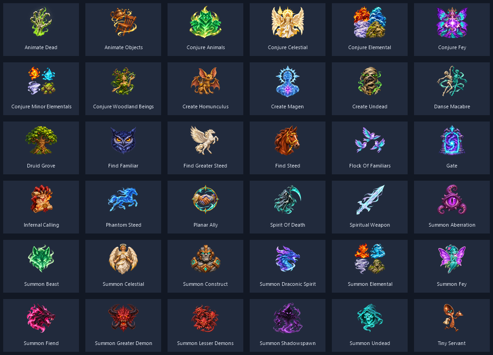

# Quick Summon

[English](README.md) · [Son sürümü indir](https://github.com/alperozisik/FG-Quick-Summon/releases/latest) · [Değişiklik günlüğü](CHANGELOG.md)

**Quick Summon**, Fantasy Grounds Unity **5E Legacy (2014)** karakter sayfasındaki **Actions → Cast** düğmesinden başlayan bir çağırma eklentisidir. 36 büyü için yaratık seçimini, slot tüketimini, Combat Tracker kaydını ve büyüye göre ölçeklenen değerleri yönetir.

## Kurulum

1. [Releases](https://github.com/alperozisik/FG-Quick-Summon/releases) bölümündeki `QuickSummon.ext` dosyasını FG veri dizininin `extensions/` klasörüne kopyala.
2. **Spiritual Weapon** harita görseli için aynı sürümdeki `Spiritual_Weapon.png` dosyasını FG veri dizinindeki `tokens/QuickSummon/` klasörüne koy.
3. Kampanya başlatıcısında **Quick Summon**’ı etkinleştir. GM tarafında kullanılacak NPC modüllerini yükle.
4. `AFTERTURN` ve `SHARETURN` ile sıralamayı uygulamak için [Initiative Nanny](https://forge.fantasygrounds.com/shop/items/2089/view) eklentisini etkinleştir.

Yüklemede chat’te eklenti ikonuyla **Quick Summon v0.1.21 loaded.** mesajı görünür. Açık kampanyada paketi değiştirdikten sonra uygun zamanda `/reload` kullanabilirsin.

## Çağırma akışı

- **Actions → Cast** düğmesine bas. Eklenti büyü adını ve varsa kayıtlı taban seviyesini eşleştirir.
- Slot seçimi açılırsa en düşük kullanılabilir slot seçili gelir. Dolu ve tükenmiş slotlar arasındaki fark düğmelerde görünür. Upcast notu hangi seviyenin ek fayda sağladığını belirtir.
- Oyuncunun seçtiği form veya CR/adet kombinasyonundan sonra, büyü gerektiriyorsa GM uygun yaratığı seçer. Tek geçerli sonuç varsa akış otomatik ilerleyebilir.
- GM adayın adının solundaki bağlantıyla kaynak NPC sayfasını açabilir. Oyuncunun listesinde ad, tür ve CR görünür. Kataloğa GM’e açık modüller de girer ve bu modüllerdeki aday adları oyuncuya görünebilir.
- **Refresh**, modülleri ve slot durumunu yeniden okur. Penceredeki aday seçimleri sıfırlanır. **Select randomly**, en az iki geçerli aday arasından seçim yapar. **Animate Objects** için mümkün olan en yüksek boyut bütçesini doldurur.
- **Confirm** ile yaratıklar CT’ye eklenir ve kullanılan slot chat’te bildirilir. Uygunsa konsantrasyon veya süre efekti eklenir. GM token’ı CT’den haritaya sürükler.
- **Cancel** veya pencereyi kapatma, bekleyen çağırmayı iptal eder. Counterspell’i masanın normal akışında yönet.

## Combat Tracker

- **Pets** yüklüyse ve otomatik atama açıksa yeni dost summon, caster’ın Pets listesine CT’ye bağlı NPC kaydı olarak eklenir. Summon CT’den kaldırıldığında Pets kaydı da silinir. Konsantrasyon kaybıyla düşmana dönerse Pets’ten çıkar ve DM kontrolünde kalır. Pets yüklü değilse normal akış devam eder.
- **Options → Quick Summon → Auto Assign Summoned NPC**, varsayılan **On** ayarıyla dost summon’ı caster’ı kontrol eden oyuncuya verir; CT’deki NPC sayfasını o oyuncuyla paylaşır ve oyuncunun ekranında **kilitli** açar.
- Caster’ın initiative’i varsa büyünün kuralına göre bireysel zar, grup zarı veya caster’ın initiative değeri kullanılır.
- **Find Familiar** ile gelen kayda `Familiar` efekti eklenir.
- **Spiritual Weapon**, `SHARETURN` ile caster’ın turunu paylaşır. **Spiritual Weapon Strike** bonus action’ı NPC sayfası ve CT’de saldırı ve force hasarı atışları sunar. Üzerinde `Incapacitated` ve `NOREACTION` bulunur.
- Ölçeklenen ruhlar AC, HP, caster spell attack, save DC ve proficiency değerlerini kullanır. Yüklü modüldeki stat bloğunun metin yapısı, aksiyon metninin ne kadarının otomatik ölçeklenebildiğini belirler.

## Süreler ve rest

- Süreli summon’ın üzerinde **Summoned Creature** efekti bulunur. Bu efekt bittiğinde veya kaldırıldığında summon CT’den ve bağlı Pets kaydından silinir. Süre FG turları ve rest komutlarıyla ilerler; gerçek zaman sayacı değildir.
- Short rest **1 saat**, long rest **8 saat** düşürür. Toplu rest ve caster’ın kendi sayfasından yapılan rest desteklenir. Toplu rest aynı sayacı iki kez azaltmaz.
- Konsantrasyon bağlantısı caster’da kalır. Konsantrasyon kaybıyla hostile’a dönen yaratığın Summoned Creature efekti, **yaratık silinmeden** kaldırılır; kontrol DM’e geçer. Özel gecikmeli kaybolma durumları DM tarafından yönetilir.
- Kalıcı yaratıklar, familiar ve steed süre sayacı almaz. Gate kapanınca getirilen yaratık kalır. Animate Dead/Create Undead kontrol süresi, yaratığın ömründen ayrıdır. Druid Grove koruyucularında olağan 24 saat kullanılır; kalıcı grove ayrı yönetilir.
- `/reload`, mevcut summon sayfalarını kilitler ve Spiritual Weapon’ın eksik Incapacitated efektini tamamlar. Eski süre efekti bulunan summon’lara, kalan tur sayısı korunarak yeni sayaç eklenir.

[36 büyünün tam listesi ve kapsam](README.md#supported-spells). Kontrolü yenileme, konum, arazi, özel kontrol zarları ve Counterspell masada yönetilir. 2024 kural seti için ayrı otomasyon gerekir.

## Icons Preview

Chat ikonları 40 × 40 px, seçim penceresindekiler 96 × 96 px ve Spiritual Weapon harita token’ı 256 × 256 px’dir.

## Derleme ve katkı

`python build_release.py` komutu, kurulabilir eklentiyi, harita token’ını ve SHA-256 değerlerini `release/` klasörüne yazar.

Katkıda bulunmak için depoyu forklayıp değişikliklerini kendi fork’unda yap ve `main` dalına pull request aç. Sürümleri proje sahibi yayımlar.

[MIT lisansı](LICENSE).
